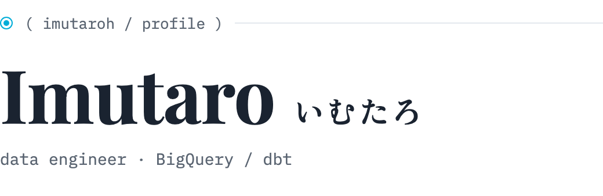
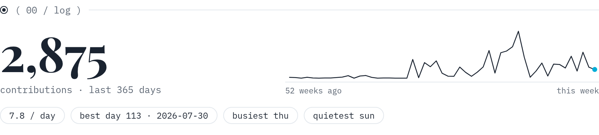

<picture>
  <source media="(prefers-color-scheme: dark)" srcset="./assets/character-dark.png">
  
</picture>

<picture>
  <source media="(prefers-color-scheme: dark)" srcset="./assets/title-dark.png">
  
</picture>

データまわりのエンジニアです。<br>

<br clear="right">

<picture>
  <source media="(prefers-color-scheme: dark)" srcset="./assets/log-dark.png">
  
</picture>

<picture>
  <source media="(prefers-color-scheme: dark)" srcset="./assets/h-profile-dark.png">
  
</picture>

```json
{
  "name": "imutaro",
  "role": "Data Engineer",
  "grade": "2026年卒",
  "base": "福岡",
  "focus": "data platform / AI",
  "site": "imutaro.com"
}
```

<picture>
  <source media="(prefers-color-scheme: dark)" srcset="./assets/h-environment-dark.png">
  
</picture>

**[Herdr](https://herdr.dev)**　·　**[Claude Code](https://claude.com/claude-code)**　·　**[Neovim](https://neovim.io)**

設定は [dotfiles](https://github.com/imutaroh/dotfiles) に置いています。

<picture>
  <source media="(prefers-color-scheme: dark)" srcset="./assets/h-writing-dark.png">
  
</picture>

**[Zenn](https://zenn.dev/imu_imu)**　·　**[note](https://note.com/imutaroh)**　·　**[notes.imutaro.com](https://notes.imutaro.com)**
