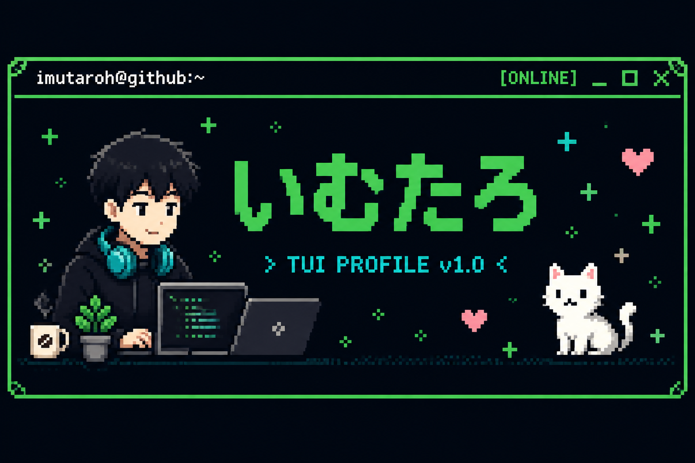

<!-- ============================================================
     imutaroh — TUI PROFILE v2.0
     (profile readme)
     ============================================================ -->

<div align="center">




<br/><br/>

<a href="https://github.com/imutaroh">
  
</a>

</div>

## 🖥️ `$ whoami`

```text
┌────────────────────────────────────────────────────┐
│  👤 名前     : いむたろ                             │
│  💼 本業     : データまわりのエンジニア（SQL / dbt） │
│  🔧 症状     : 仕事を楽にする道具を作りはじめ、      │
│               気づくと道具を作るほうが本編になる    │
│  🤖 相棒     : Claude Code（だいたい隣のペインにいる）│
│  ✍️ 発信     : Zenn（技術） / note（体験談）         │
└────────────────────────────────────────────────────┘
```

## 📦 `$ ls ~/shipped`

作ったものを並べたら、ほとんどが「AI エージェントに指示を出すための道具」でした。

| | なにこれ | ひとこと |
| --- | --- | --- |
| ⏱️ | **[pomo](https://github.com/imutaroh/pomo)**<br/><sub>Swift / macOS</sub> | 機能を足すのではなく、消していったタイマー。履歴もストリークもありません。なので、このページにもストリークは置いていません |
| 🔍 | **[diffbase.nvim](https://github.com/imutaroh/diffbase.nvim)**<br/><sub>Lua / Neovim</sub> | いつもの編集画面が、そのまま GitHub の PR 差分になる。差分を見るためだけにタブを開くのが面倒だった人の作品 |
| 💬 | **[nudge.nvim](https://github.com/imutaroh/nudge.nvim)**<br/><sub>Lua / Neovim</sub> | コードの行にコメントを溜めて、AI エージェントへまとめて送る。PR レビューの相手が AI になっただけ |
| 🖍️ | **[herdr-redpen](https://github.com/imutaroh/herdr-redpen)**<br/><sub>JavaScript / Herdr mod</sub> | AI の返答に、ブロックごとに赤ペンを入れて送り返す。添削される側から、する側へ |
| 🗂️ | **[herdr-tab-groups](https://github.com/imutaroh/herdr-tab-groups)**<br/><sub>JavaScript / Herdr mod</sub> | エージェントを増やしすぎてタブが溢れたので、Chrome 風のタブグループを作った。原因は自分 |
| 📚 | **[kindle-screenshot-app](https://github.com/imutaroh/kindle-screenshot-app)**<br/><sub>Go</sub> | Kindle for Mac を 1 ページずつ撮って PDF と Markdown にする。主な使い手は人間ではなく Claude Code |
| 🏠 | **[dotfiles](https://github.com/imutaroh/dotfiles)** | 上の全部が住んでいる家。設定ファイルというより、だいたい本体 |

## 📊 `$ cat stats.txt`

<div align="center">

<p>
  <a href="https://github.com/imutaroh?tab=followers"></a>
  
  
</p>

<sub>↑ 数字が小さいのは仕様です。伸びしろと呼んでいます。Star を 1 つ押すと、統計が目に見えて動きます</sub>

<br/><br/>


</div>

## ✍️ `$ ls ~/writing`

<div align="center">

<a href="https://zenn.dev/imu_imu">
  
</a>
&nbsp;
<a href="https://note.com/imutaroh">
  
</a>
&nbsp;
<a href="https://notes.imutaro.com">
  
</a>

<br/>

<sub>Zenn = 技術のはなし / note = 新卒エンジニアの体験談 / notes = 学んだことの置き場</sub>

</div>

<br/>

<div align="center">


</div>
